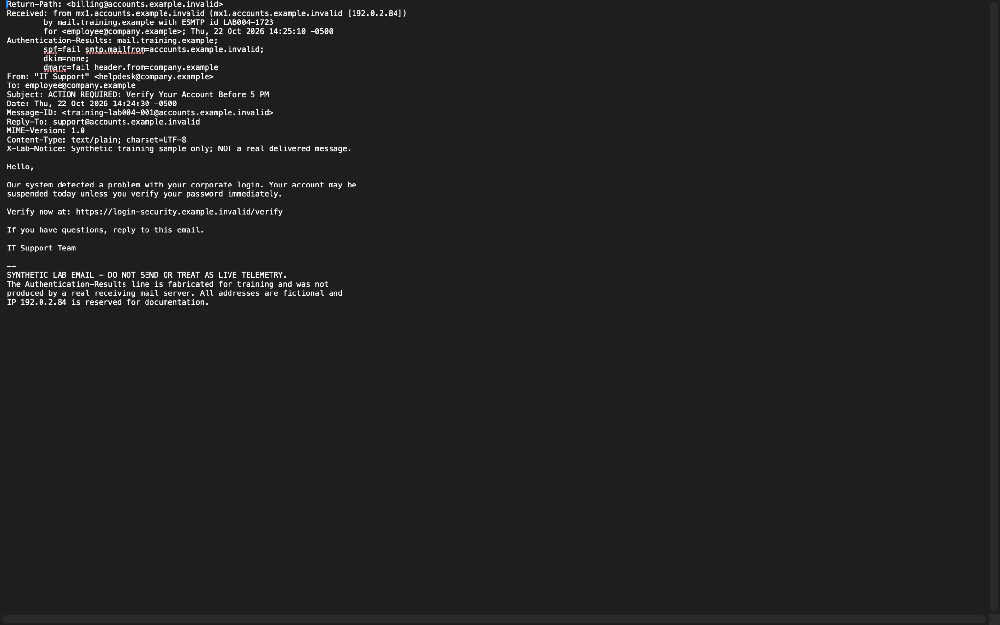
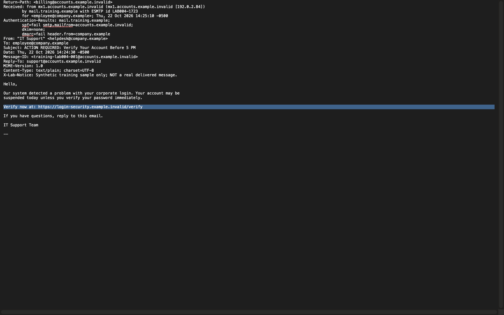
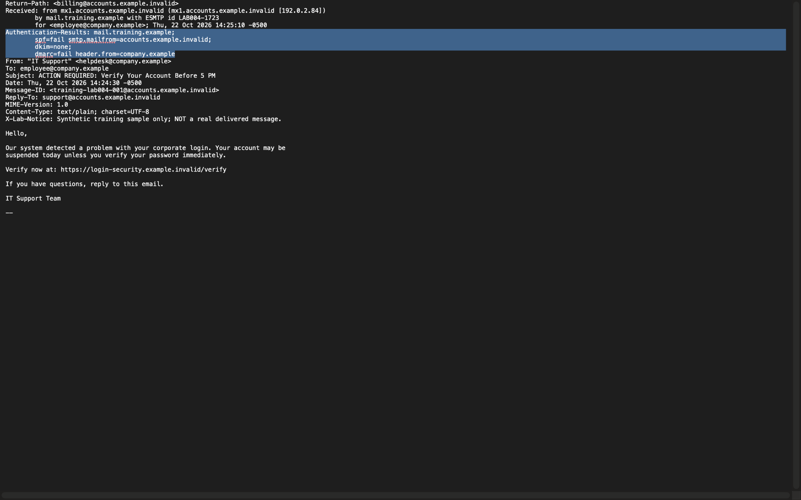

# Phishing Email Investigation | SOC Case 004

**Tier 1 SOC phishing triage · Email header analysis · SPF / DKIM / DMARC · Safe IOC review**

> **Synthetic training case:** This project analyzes a fabricated `.eml` message. The authentication results and Received header are illustrative, **not actual mail-server verification**. The sample was not delivered to a real inbox, and no URL was visited or credentials exposed.

## Investigation summary

I investigated a simulated email impersonating corporate IT support and requesting urgent password verification. Using TextEdit on macOS, I examined the raw `.eml` source without opening links, compared the visible sender with the envelope sender and Reply-To, interpreted the *supplied* authentication header, and documented observable evidence and a final SOC triage verdict.

| Case property | Value |
|---|---|
| Case | LAB-004 |
| Message subject | `ACTION REQUIRED: Verify Your Account Before 5 PM` |
| Message date (synthetic) | 2026-10-22 14:24:30 -0500 |
| Tool | TextEdit on macOS, static `.eml` source inspection |
| Classification | **Credential phishing attempt (simulated)** |
| Priority | High for training scenario, not an operational severity determination |
| Impact | No observed click, credential theft, delivery or compromise |

## Analyst verdict

**Credential phishing attempt (simulated).** The sample combines an IT-support impersonation claim, sender-domain inconsistencies, a password-verification request, a threatened account suspension, and a verification URL outside the claimed sender domain. Fabricated SPF, DKIM and DMARC results add training context but must not be described as actual authentication checks.

## Evidence walkthrough

### 1. Raw email headers and body

The email presents `helpdesk@company.example` as the visible sender but supplies an unrelated envelope sender. The header and body are preserved in the original `.eml`.

### 2. Verification URL and social engineering

The text urges immediate action and includes `https://login-security.example.invalid/verify`. The `.invalid` top-level domain is reserved and used here only as a nonfunctional training destination. HTTPS alone does not establish trustworthiness.

### 3. Fabricated email authentication results

The illustrative `Authentication-Results` header states SPF fail, DKIM none and DMARC fail. Real investigations would validate such results in the receiving mail platform; an untrusted message can also contain forged headers.

## Header findings

| Header | Value | Analyst interpretation |
|---|---|---|
| `From` | `IT Support <helpdesk@company.example>` | Claimed corporate IT identity |
| `Return-Path` | `billing@accounts.example.invalid` | Different sending domain |
| `Reply-To` | `support@accounts.example.invalid` | Replies directed outside claimed company domain |
| `Received` | `192.0.2.84` | Reserved TEST-NET-1 documentation address, not real attacker infrastructure |
| `SPF` | `fail` | **Fabricated** sender authorization result |
| `DKIM` | `none` | **Fabricated** no-signature result |
| `DMARC` | `fail` | **Fabricated** domain authentication/alignment result |

The sender-domain mismatch alone is not proof of abuse; outsourced sending services can be legitimate. The full pattern drives the training verdict.

## Indicators and artifacts

| Type | Example | Handling |
|---|---|---|
| Sender | `helpdesk@company.example` | Claimed identity; fictional domain |
| Envelope sender | `billing@accounts.example.invalid` | Synthetic address |
| Reply-To | `support@accounts.example.invalid` | Synthetic address |
| Source IP | `192.0.2.84` | Reserved documentation address; **do not block as a real IOC** |
| Verification URL | `https://login-security.example.invalid/verify` | Reserved nonfunctional URL; **not visited** |
| Message ID | `training-lab004-001@accounts.example.invalid` | Synthetic correlation artifact |

## Recommended Tier 1 SOC response in a real environment

1. Preserve the reported email and original headers without altering the evidence.
2. Verify SPF, DKIM, DMARC alignment and message delivery through the mail security platform.
3. Scope other recipients and related messages using sender, message ID, subject and URL indicators.
4. Assess any URL using an approved analysis workflow; never enter credentials or interact with unknown links directly.
5. Quarantine confirmed malicious messages and apply blocks only after validation and according to policy.
6. If user interaction or credential submission is confirmed, escalate for identity containment (password resets, session revocation, MFA and sign-in review).
7. Document findings, confidence, unknowns and handoff to the next analyst.

**In this lab, no message was quarantined, URL was visited, DNS lookup was performed, or account response was carried out.**

## Report and original evidence

- [SOC Case 004 Investigation Report (Word)](reports/SOC_Case_004_Phishing_Investigation_Report.docx)
- [Original synthetic email (.eml)](evidence/Lab_004_Simulated_Phishing_Email.eml)

## Skills demonstrated

Phishing triage · Raw email header inspection · SPF/DKIM/DMARC interpretation · Sender impersonation assessment · URL structure analysis · IOC documentation · Evidence handling · SOC incident reporting · Scope and escalation decisions

## Limitations

This is a **static single-message training exercise**, not a Microsoft Defender investigation or analysis of a real phishing campaign. The sample contains no live malicious infrastructure. Its `Authentication-Results` header and mail routing data were authored for practice. The available evidence cannot demonstrate actual delivery, click-through, credential theft, or compromised systems.

---

**Project status:** Completed synthetic phishing email triage. All example indicators are fictional or reserved for documentation.
